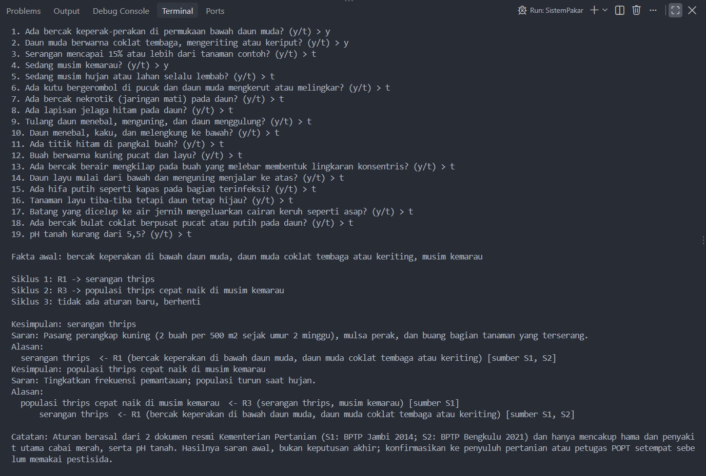
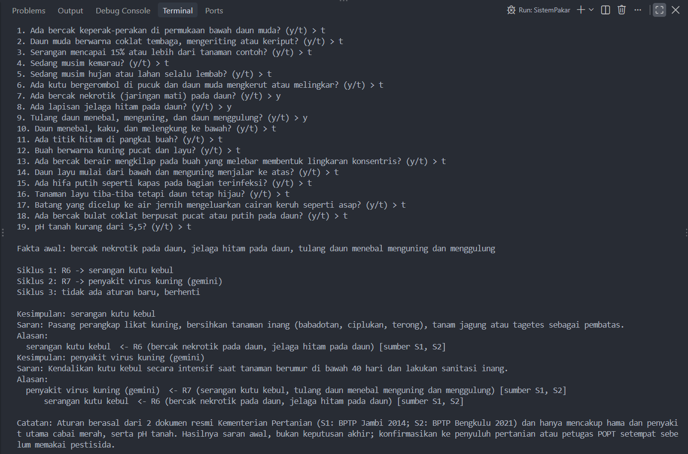
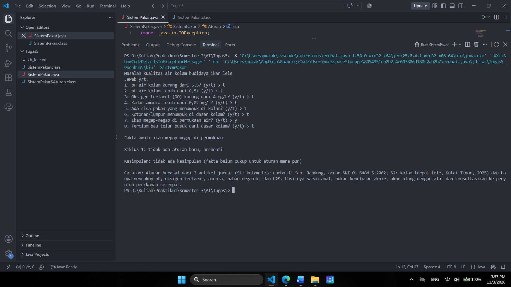

# AI-Tugas5-F1D02510018
# Sistem Pakar Masalah Kualitas Air Kolam Lele (Forward Chaining)

## 1. Identitas
- Nama : **Muzakir Mataho**
- NIM  : **F1D02510018**

## 2. Topik dan cara menjalankan
Topik: masalah kualitas air kolam budidaya ikan lele (pH, oksigen terlarut, amonia, bahan organik, H2S).

- Bahasa: Java 11 atau lebih baru (JDK 21 saat diuji), tanpa library tambahan
- Interaktif: `java SistemPakar.java` (atau `javac SistemPakar.java` lalu `java SistemPakar`)
- Mode uji (tanpa tanya, fakta dipisah `;`): `java SistemPakar.java --ya "pH air kurang dari 6,5"`

File: `kb_lele.txt` (aturan + sumber, format teks karena Java tidak punya pembaca JSON bawaan), `SistemPakar.java` (mesin FC buatan sendiri), `screenshot/`.

## 3. Sumber dan aturan
**S1** Kelana, P.P., Subhan, U., Suryadi, I.B.B., Haris, R.B.K. (2021). *Studi Kesesuaian Kualitas Air untuk Budidaya Ikan Lele Dumbo (Clarias gariepinus) di Kampung Lauk Kabupaten Bandung*. Aurelia Journal 2(2): 159-164. Politeknik KP Dumai & Universitas Padjadjaran. https://www.researchgate.net/profile/Ibnu-Bangkit/publication/353545314_STUDI_KESESUAIAN_KUALITAS_AIR_UNTUK_BUDIDAYA_IKAN_LELE_DUMBO_Clarias_gariepinus_DI_KAMPUNG_LAUK_KABUPATEN_BANDUNG/links/610223f51e95fe241a95d6f7/STUDI-KESESUAIAN-KUALITAS-AIR-UNTUK-BUDIDAYA-IKAN-LELE-DUMBO-Clarias-gariepinus-DI-KAMPUNG-LAUK-KABUPATEN-BANDUNG.pdf (diakses 3 Nov 2026)

**S2** Haryasakti, A., Rudyanto, Kaharuddin, Wahyudi, M.H. (2025). *Efektivitas Bakteri Fotosintetik Rhobac dalam Meningkatkan Kualitas Air pada Budidaya Ikan Lele di Kolam Terpal*. Jurnal Pertanian Terpadu 13(1): 43-52. STIPER Kutai Timur. https://ojs.stiperkutim.ac.id/index.php/jpt/article/download/610/296 (diakses 3 Nov 2026)

| Aturan | IF | THEN | Sumber |
|---|---|---|---|
| R1 | pH < 6,5 | air terlalu asam | S1 |
| R2 | pH > 8,5 | air terlalu basa | S1 |
| R3 | DO < 4 mg/L | oksigen rendah | S1 |
| R4 | sisa pakan menumpuk **OR** kotoran/lumpur dasar menumpuk | bahan organik tinggi | S1, S2 |
| R5 | air terlalu asam | lakukan pengapuran, ukur pH ulang | S1, S2 |
| R6 | bahan organik tinggi **AND** amonia > 0,02 mg/L | amonia menumpuk dari sisa pakan/kotoran | S1, S2 |
| R7 | air terlalu basa **AND** amonia > 0,02 mg/L | amonia makin beracun karena pH tinggi | S1 |
| R8 | oksigen rendah **AND** ikan megap-megap | hipoksia, segera aerasi | S1, S2 |
| R9 | oksigen rendah **AND** bau telur busuk dari dasar kolam | risiko H2S, tambah aerasi/sirkulasi | S2 |

Rantai aturan: R1 -> R5, R2 -> R7, R3 -> R8/R9, R4 -> R6. Ada 5 kesimpulan akhir (R5-R9).
Ambang pH 6,5-8,5 dan DO > 4 mg/L dari SNI 01-6484.5:2002 sebagaimana dikutip S1; amonia < 0,02 mg/L untuk kolam terpal dari S2 (S1 memakai acuan SNI yang lebih ketat, < 0,01 mg/L).

## 4. Metode: Forward Chaining
Dipilih karena user biasanya sudah punya hasil ukur/pengamatan (fakta) dan ingin tahu apa akibatnya. FC cocok untuk alur data -> kesimpulan.

```
memori <- fakta yang dijawab "ya"
ULANGI:
    cocok <- aturan yang syaratnya terpenuhi DAN hasilnya belum ada di memori
    JIKA cocok kosong: BERHENTI
    r <- cocok[0]; tambahkan r.maka ke memori; catat asalnya (r)
```
Kesimpulan akhir = hasil yang tidak dipakai sebagai syarat aturan lain. Alasan dicetak dengan menelusuri balik aturan penghasilnya.

## 5. Kasus uji
| # | Jawaban "ya" | Hasil |
|---|---|---|
| 1 | pH < 6,5 | lakukan pengapuran (R1 -> R5) |
| 2 | DO < 4, megap-megap, bau telur busuk | hipoksia (R3 -> R8) dan risiko H2S (R3 -> R9) |
| 3 | hanya ikan megap-megap | **tidak ada kesimpulan** (kasus negatif) |
| 4 | pH > 8,5, amonia > 0,02, sisa pakan | R6 dan R7 (rantai R4 dan R2) |

**Screenshot :**





## 6. Batas keberlakuan
Pengetahuan dalam sistem ini berasal dari dua artikel jurnal perikanan Indonesia (kolam lele dumbo di Kabupaten Bandung dan kolam terpal di Kutai Timur), bukan dari penelitian saya sendiri. Aturan hanya berlaku untuk budidaya lele di kolam air tawar dan hanya mencakup pH, oksigen terlarut, amonia, bahan organik, dan H2S; penyebab lain (penyakit, kualitas benih, kualitas pakan) tidak dicakup. Hasilnya berupa saran awal, bukan keputusan akhir. Ukur ulang dengan alat yang terkalibrasi dan konsultasikan dengan penyuluh perikanan setempat sebelum bertindak. Peringatan ini juga ditampilkan oleh program.
## 7. Penggunaan alat bantu AI
Saya memakai Claude (Anthropic) untuk mencari sumber jurnal dan menyusun
draf aturan, kode Java, dan README. Saya sudah membaca kedua sumber,
menjalankan program sendiri, dan memahami cara kerja kode serta aturannya.
