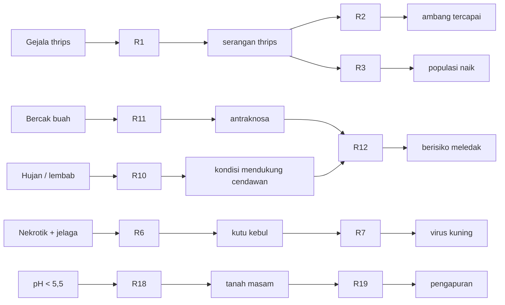
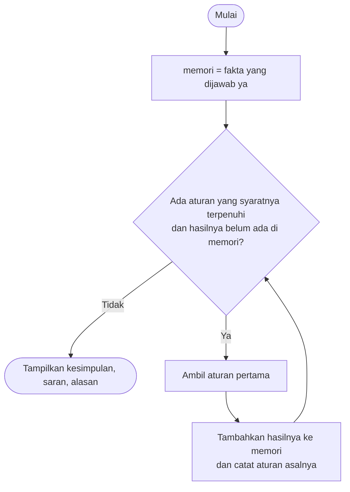

<div align="center">

# 🌶️ Sistem Pakar Hama dan Penyakit Tanaman Cabai

**Diagnosis gejala di kebun cabai dengan metode *Forward Chaining*, lengkap dengan alasan dan saran penanganan.**


*Tugas 5 Kecerdasan Buatan, Membuat Sistem Pakar Sederhana*

</div>

---

## 📑 Daftar Isi
1. [Identitas](#1-identitas)
2. [Topik dan Cara Menjalankan](#2-topik-dan-cara-menjalankan)
3. [Sumber dan Aturan](#3-sumber-dan-aturan)
4. [Metode: Forward Chaining](#4-metode-forward-chaining)
5. [Kasus Uji dan Screenshot](#5-kasus-uji-dan-screenshot)
6. [Batas Keberlakuan](#6-batas-keberlakuan)
7. [Penggunaan Alat Bantu AI](#7-penggunaan-alat-bantu-ai)

---

## 1. Identitas

| | |
|---|---|
| **Nama** | Muzakir Mataho |
| **NIM** | F1D02510018 |

---

## 2. Topik dan Cara Menjalankan

**Topik:** diagnosis hama dan penyakit utama cabai merah (thrips, kutu daun, kutu kebul, tungau, lalat buah, antraknosa, layu Fusarium, layu bakteri, bercak daun Cercospora, virus kuning) serta kebutuhan pengapuran berdasarkan pH tanah.

**Cara kerjanya:** pengguna menjawab 19 pertanyaan ya/tidak tentang gejala di lapangan. Program menjalankan aturan IF-THEN secara berantai, lalu menampilkan **kesimpulan**, **saran**, dan **alasan** (aturan mana yang dipakai).

### ▶️ Menjalankan

| Kebutuhan | Keterangan |
|---|---|
| Bahasa | Java 11 atau lebih baru (diuji dengan JDK 21), tanpa library tambahan |
| Folder kerja | jalankan dari folder yang berisi `kb_cabai.txt` |

```bash
# Mode interaktif (ditanya y/t)
java SistemPakar.java

# Mode uji, tanpa tanya (fakta dipisah tanda titik koma)
java SistemPakar.java --ya "musim hujan atau lahan lembab;bercak berair mengkilap berlingkar konsentris pada buah"

# Atau cara klasik
javac SistemPakar.java
java SistemPakar
```

### 📂 Struktur Repository

```
.
├── SistemPakar.java   # mesin Forward Chaining buatan sendiri
├── kb_cabai.txt       # basis pengetahuan: sumber, pertanyaan, 19 aturan
├── README.md
└── screenshot/        # bukti 3 kasus uji
```

---

## 3. Sumber dan Aturan

### 📚 Sumber

| ID | Rujukan |
|---|---|
| **S1** | Meilin, A. (2014). *Hama dan Penyakit pada Tanaman Cabai serta Pengendaliannya*. BPTP Jambi, Badan Litbang Pertanian, Kementerian Pertanian. <https://www.academia.edu/32946554/HAMA_DAN_PENYAKIT_PADA_TANAMAN_CABAI_SERTA_PENGENDALIANNYA_BALAI_PENGKAJIAN_TEKNOLOGI_PERTANIAN_BPTP_JAMBI> (diakses 3 Nov 2026) |
| **S2** | Dinata, K., Oktavia, Y., Astuti, H.B., dkk. (2021). *Budidaya, Produksi Benih dan Pascapanen Cabai Merah*. BPTP Bengkulu, Badan Litbang Pertanian, Kementerian Pertanian. <https://www.studocu.id/id/document/institut-pertanian-bogor/pengantar-ilmu-pertanian/budidaya-dan-produksi-benih-cabai-merah-pascapanen-2021/153619801?sid=78ba99b2-58bb-4622-b882-2e0c884b024c1794367195> (diakses 3 Nov 2026) |

### 🧩 Tabel Aturan IF-THEN

| Aturan | IF | THEN | Sumber |
|---|---|---|---|
| R1 | bercak keperakan di bawah daun muda **AND** daun muda coklat tembaga/keriting | serangan thrips | S1, S2 |
| R2 | serangan thrips **AND** serangan ≥ 15% | ambang pengendalian thrips tercapai | S1 |
| R3 | serangan thrips **AND** musim kemarau | populasi thrips cepat naik | S1 |
| R4 | kutu bergerombol dan daun muda mengkerut | serangan kutu daun | S1, S2 |
| R5 | serangan kutu daun **AND** musim kemarau | serangan kutu daun berat | S1, S2 |
| R6 | bercak nekrotik **AND** jelaga hitam pada daun | serangan kutu kebul | S1, S2 |
| R7 | serangan kutu kebul **AND** tulang daun menebal, menguning, menggulung | penyakit virus kuning (gemini) | S1, S2 |
| R8 | daun kaku melengkung ke bawah **AND** daun coklat tembaga/keriting | serangan tungau | S1, S2 |
| R9 | titik hitam di pangkal buah **AND** buah kuning pucat dan layu | serangan lalat buah | S1, S2 |
| R10 | musim hujan atau lahan lembab | kondisi mendukung cendawan | S1 |
| R11 | bercak berair mengkilap berlingkar konsentris pada buah | busuk buah antraknosa | S1, S2 |
| R12 | busuk buah antraknosa **AND** kondisi mendukung cendawan | antraknosa berisiko meledak | S1, S2 |
| R13 | daun layu dari bawah dan menguning **AND** hifa putih seperti kapas | layu Fusarium | S1, S2 |
| R14 | layu tiba-tiba daun tetap hijau **AND** cairan keruh seperti asap di air | layu bakteri Ralstonia | S1, S2 |
| R15 | layu Fusarium **OR** layu bakteri Ralstonia | sanitasi tanaman layu | S1, S2 |
| R16 | bercak bulat coklat berpusat pucat | bercak daun Cercospora | S1 |
| R17 | bercak daun Cercospora **AND** kondisi mendukung cendawan | bercak daun Cercospora berisiko menyebar | S1 |
| R18 | pH tanah < 5,5 | tanah terlalu masam | S2 |
| R19 | tanah terlalu masam | perlu pengapuran dolomit | S2 |

> Ambang 15% (thrips) dan 50 kutu per tanaman (kutu daun) dari S1. Rentang pH sesuai 6 sampai 7 dan fase rentan kutu kebul di bawah 40 hari dari S2.

### 🔗 Rantai Aturan

Beberapa aturan memakai hasil aturan lain, itulah yang membuat *chaining* terjadi.



---

## 4. Metode: Forward Chaining

**Alasan memilih FC:** petani biasanya sudah punya pengamatan lapangan (gejala, musim, pH tanah) dan ingin tahu penyebab serta tindakannya. *Forward chaining* bergerak dari fakta menuju kesimpulan, jadi cocok untuk alur ini.



**Pseudocode:**

```
memori <- fakta yang dijawab "ya"
ULANGI:
    cocok <- aturan yang syaratnya terpenuhi DAN hasilnya belum ada di memori
    JIKA cocok kosong: BERHENTI
    r <- cocok[0]; tambahkan r.maka ke memori; catat asalnya (r)
```

- Mode `dan`: semua syarat harus ada di memori. Mode `atau`: salah satu cukup.
- Aturan yang hasilnya sudah ada tidak dijalankan lagi, supaya program tidak berputar tanpa henti.
- Hasil aturan yang ditandai `akhir = y` di `kb_cabai.txt` ditampilkan sebagai kesimpulan beserta saran. **Alasan** dicetak dengan menelusuri balik aturan penghasilnya secara rekursif.

---

## 5. Kasus Uji dan Screenshot

<details>
<summary><b>Urutan 19 pertanyaan (klik untuk membuka)</b></summary>

1. Bercak keperak-perakan di bawah daun muda
2. Daun muda coklat tembaga, keriting, atau keriput
3. Serangan mencapai 15% atau lebih
4. Musim kemarau
5. Musim hujan atau lahan lembab
6. Kutu bergerombol di pucuk dan daun muda mengkerut
7. Bercak nekrotik pada daun
8. Jelaga hitam pada daun
9. Tulang daun menebal, menguning, dan daun menggulung
10. Daun menebal, kaku, melengkung ke bawah
11. Titik hitam di pangkal buah
12. Buah kuning pucat dan layu
13. Bercak berair mengkilap pada buah berlingkar konsentris
14. Daun layu dari bawah dan menguning
15. Hifa putih seperti kapas
16. Layu tiba-tiba, daun tetap hijau
17. Cairan keruh seperti asap saat batang dicelup air
18. Bercak bulat coklat berpusat pucat
19. pH tanah kurang dari 5,5

</details>

| # | Jawaban "ya" (nomor) | Hasil yang diharapkan |
|---|---|---|
| 1 | 1, 2, 4 | serangan thrips (R1), populasi cepat naik di kemarau (R3) |
| 2 | 7, 8, 9 | serangan kutu kebul (R6), virus kuning (R7) |
| 3 | 16 saja | **tidak ada kesimpulan** (kasus negatif) |
| 4 | 5, 13 | antraknosa (R11), berisiko meledak (R12) |

### 📸 Screenshot

**Kasus 1: thrips di musim kemarau**


**Kasus 2: kutu kebul dan virus kuning**


**Kasus 3: tidak menghasilkan kesimpulan (kasus negatif)**


### 🖥️ Contoh keluaran program (kasus 2)

```
Siklus 1: R6 -> serangan kutu kebul
Siklus 2: R7 -> penyakit virus kuning (gemini)
Siklus 3: tidak ada aturan baru, berhenti

Kesimpulan: penyakit virus kuning (gemini)
Saran: Kendalikan kutu kebul secara intensif saat tanaman berumur di bawah 40 hari dan lakukan sanitasi inang.
Alasan:
  penyakit virus kuning (gemini)  <- R7 (serangan kutu kebul, tulang daun menebal menguning dan menggulung) [sumber S1, S2]
      serangan kutu kebul  <- R6 (bercak nekrotik pada daun, jelaga hitam pada daun) [sumber S1, S2]
```

---

## 6. Batas Keberlakuan

Pengetahuan dalam sistem ini berasal dari dua dokumen resmi Badan Litbang Pertanian, Kementerian Pertanian (BPTP Jambi 2014 dan BPTP Bengkulu 2021), bukan dari penelitian saya sendiri. Aturan berlaku untuk budidaya cabai merah di Indonesia dan hanya mencakup hama dan penyakit yang disebut kedua dokumen serta pH tanah; kekurangan hara, keracunan pestisida, dan penyakit lain tidak dicakup, dan gejala yang mirip (misalnya thrips dan tungau) dapat muncul bersamaan. Hasilnya berupa saran awal, bukan keputusan akhir. Konfirmasikan dengan penyuluh pertanian atau petugas pengamat OPT setempat sebelum memakai pestisida. Peringatan ini juga ditampilkan oleh program.

---

## 7. Penggunaan Alat Bantu AI

Saya menggunakan **Claude (Anthropic)** sebagai alat bantu dalam tugas ini, dengan rincian:

- **Menyusun kode:** kerangka program Java (pembaca file aturan, mesin *forward chaining*, dan penelusuran alasan).
- **Menyusun README:** struktur, tabel, diagram, dan penulisan dokumentasi ini.
- **Mencari sumber dan menyusun draf aturan:** membantu menemukan dokumen Kementerian Pertanian dan merumuskan aturan IF-THEN dari isinya.

Saya sudah membaca kedua sumber, menjalankan program dan menguji kasus ujinya sendiri, serta memahami cara kerja kode dan aturan yang ada di repository ini.
